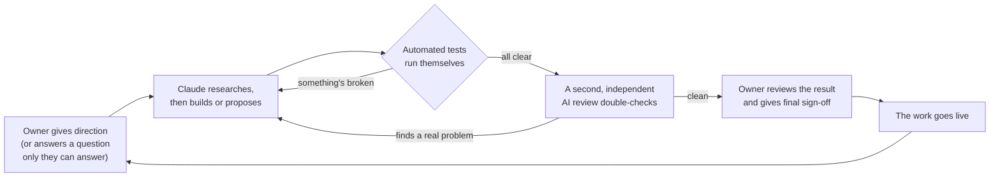
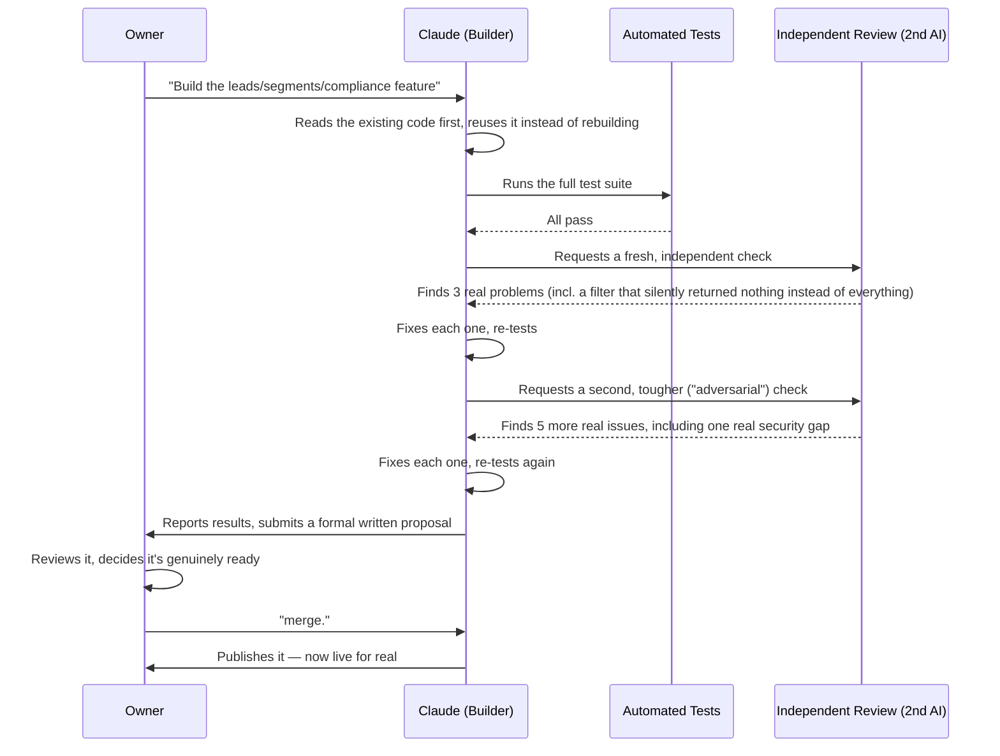
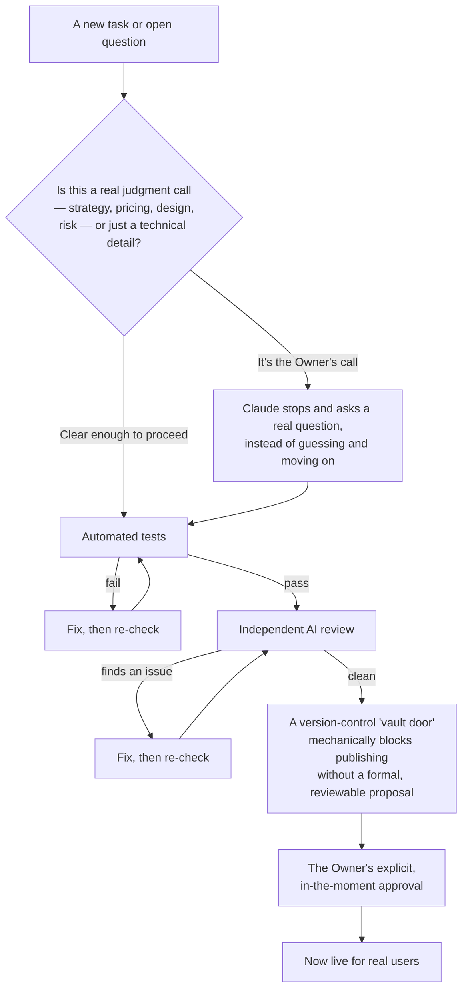

# How This Actually Got Built — A Beginner's Case Study in AI-Led Development

**Who this is for:** someone with no software background at all, but real
instincts for how businesses work — how decisions get made, how quality
gets controlled, how a project accumulates progress instead of
reinventing itself every week, and how trust gets built between a
principal and the people (or tools) doing the work for them. If that's
you, you already have most of what you need to understand this. The rest
is just vocabulary, which this document explains as it goes.

**What this is:** a true account of how two real software products
(referred to here simply as "the platform") were built by an AI agent —
Claude, made by Anthropic — working under the direction of a human owner,
over many real work sessions. Every example below really happened. Nothing
is simplified into a fictional story; it's simplified in *language*, not
in truth.

**Why it lives in this particular repository:** this repository (the
"AI Agent Governance Kit") is the rulebook that came out of the real
project this case study describes — every policy in it was extracted from
something that actually happened, not written in the abstract. This
document is the companion piece: it shows what the rulebook looks like
*in motion*, for a reader who isn't going to read the rulebook itself.

---

## The short version, if you read nothing else

- An AI agent did the actual building work — writing code, testing it,
  researching questions, fixing its own mistakes.
- A human owner stayed in charge of every decision that actually mattered
  — direction, risk, judgment calls, and the final "yes, ship it."
- Nothing became official just because the AI finished it. Everything
  passed through **layers of checking** first — automated tests, a
  second independent AI review, and a human sign-off — before it became
  real.
- Progress **accumulated** instead of restarting, because every decision
  and every open question got written down in living documents, the way
  a well-run company keeps meeting minutes and a decision log instead of
  relying on everyone's memory.
- When the AI hit a decision that was genuinely the owner's to make —
  not a technical detail, but a real business or design choice — it
  stopped and asked, instead of guessing and moving on.
- Mistakes happened. The system is not "the AI never makes an error" —
  it's "an error gets caught by something else before it costs anything
  real." Two real examples of that are in this document, not hidden.

---

## Chapter 1 — Meet the cast

Think of this less like "a person talking to a chatbot" and more like a
small, well-run team with clear roles:

| Role | Who plays it | Business equivalent |
|---|---|---|
| **The Owner** | A real person | The founder/CEO — sets direction, owns the risk, makes the calls nobody else is allowed to make |
| **The Builder** | Claude (the AI) | A very fast, very capable contractor — does the actual work, but works *for* the Owner, not instead of them |
| **The Second Opinion** | Also Claude, but a fresh, independent instance with no memory of the first one's work | An outside auditor brought in specifically because they *don't* already agree with the first person's assumptions |
| **The Inspectors** | Automated tests, run by computer, every single time | A factory's quality-control checklist — runs the same way every time, never gets tired, never skips a step |
| **The Vault Door** | A piece of the actual version-control system, configured to physically refuse certain actions | The difference between a sign that says "please don't" and a door that mechanically won't open without the right key |

The single most important idea in this whole document is that **these
roles never collapse into one.** The Builder never gets to also be the
only Inspector, the only Second Opinion, and the only approver of its own
work. That separation is the entire point — it's the same reason a
company doesn't let the same person write the check *and* approve the
expense report.

---

## Chapter 2 — What a normal work cycle actually looks like

Here is the real, repeating loop that produced everything in this
project. Read the diagram, then the plain-English walkthrough underneath
it.

**In plain terms:** the Owner says what's needed (or answers a question
the Builder couldn't answer on its own). The Builder goes and does it —
which usually means *reading what already exists first*, the same way a
good contractor checks the existing wiring before adding a new outlet,
rather than ripping everything out and starting fresh. Then, before
anyone calls it "done," it has to survive three separate checks: an
automatic one (tests), an independent human-free one (the second AI
review), and a human one (the Owner's actual sign-off). Only after all
three does it become the real, live version everyone else sees.

This loop ran dozens of times over the life of the project. It's not a
special procedure reserved for big moments — it's just how work happens
here, every time, the same way a restaurant doesn't skip its health
checklist just because the kitchen is having a slow night.

---

## Chapter 3 — A real example, start to finish

Here's one real piece of work from this project — a feature that let one
part of the platform (the sales side) pull real data from another part
(the operations side). This is not a simplified example; it's what
literally happened, condensed.

A few things worth pointing out, because they're easy to miss on a first
read:

- **The first review found real problems, and it still wasn't the last
  check.** Passing one inspection didn't mean skipping the next one. This
  is exactly like a document going through a first proofread *and* a
  second, independent copy-edit before it's allowed to print — one pass
  rarely catches everything, and knowing that in advance is what "quality
  control" actually means, rather than just hoping one look is enough.
- **The security gap the second review found is a good example of why
  independence matters.** It was a real, genuine issue — a piece of code
  that would have let anyone in the same account see more customer
  contact data than they should, with no record of who looked. The
  person (or AI) who *wrote* a thing is statistically the worst-positioned
  person to *also* be the one who catches what's wrong with it, because
  they already believe it's right. A fresh reviewer, with no attachment to
  the original work, is far more likely to actually find the problem.
- **The Owner's one-word "merge." at the end is not a formality.** Up to
  that point, nothing was live. The Builder could recommend, test, and
  polish all it wanted — the actual decision to make it real still
  required the Owner, explicitly, in the moment. Nothing "auto-published"
  itself just because it passed every check.

---

## Chapter 4 — What stays a human decision, always

Some things in this project were never treated as the AI's call to make,
no matter how confident it might have been. This is the part that most
directly answers "how was AI being controlled" — not through a single big
rule, but through several different kinds of boundaries stacked together.

A few real examples of each kind of boundary, because "boundaries exist"
means very little without seeing them actually hold:

**Judgment calls got asked, not guessed.** When it came time to design
part of the sales screen's layout, the honest answer was "there are three
reasonable options, and picking one is a real design decision, not a
technical one." Rather than picking the one that seemed most reasonable
and moving on, the Owner was asked directly — and the real answer turned
out to be more nuanced than any of the three original options (*"we could
need all of the above... perform a research about this"*), which sent
the Builder off to do real research and come back with a proposal instead
of a guess. The same happened with pricing strategy (what's free vs.
paid) and with naming the product's front door. Guessing on things like
that and quietly moving forward would have been faster in the moment and
wrong in exactly the way that's expensive to undo later.

**The "vault door" is a literal, mechanical thing, not a polite request.**
The project's version-control system is configured so that publishing a
change directly, bypassing the formal review process, is *refused by the
software itself* — not just discouraged in a document nobody reads under
deadline pressure. This actually triggered, for real, during this
project: an attempt to publish a change directly was rejected outright by
the system, with an explanation of the correct path and an explicit,
named exception process for the rare genuine emergency. The difference
between a rule that's *written down* and a rule that's *enforced by the
tool itself* is one of the biggest ideas in this whole document — the
same way a building's fire door doesn't rely on everyone remembering not
to prop it open.

**Even a task the Owner clearly authorized still paused at the real
publish step.** Earlier in this exact project, the Owner had already said
"go ahead and merge" in general terms — but when the actual publish
action ran, the system itself refused it a second time, specifically
because that particular action (merging without a fresh, in-the-moment
human review) is treated as too consequential to act on from an earlier,
more general instruction. It genuinely stopped and waited for the Owner
to say it again, directly, in that exact moment. That's not the system
being difficult — it's the same reason a bank makes you re-authenticate
for a large transfer even if you're already logged in.

**Some things simply can't be done by the AI at all, and that's treated
as normal, not a failure.** Logging into someone else's account requires
that actual person to click "approve" on their own device — there's no
way around that, and there shouldn't be. When this came up in the
project, the honest answer was "here's exactly what's needed, and here's
who needs to do it" rather than pretending there was a clever workaround.

---

## Chapter 5 — How progress accumulated instead of restarting

This is the part a business-minded reader will probably recognize
fastest, because it's the same idea as good **institutional memory**: a
new employee shouldn't have to re-derive the company's decisions from
scratch just because they weren't in the room when those decisions were
made.

The AI in this project does not remember previous work sessions the way
a person remembers yesterday. Each session genuinely starts fresh. What
made that not matter was a **living paper trail** — a small set of
documents that got updated *every single time* something real happened,
functioning exactly like a company's meeting minutes and decision log:

- **A running task list** of real work not yet done — so nothing existed
  only in someone's memory of a conversation.
- **A decisions log** for the genuinely open, cross-cutting questions
  (pricing, access control, layout) — tracking not just *that* something
  was undecided, but *why*, and what the Owner had actually said about it
  so far, so the same ground never got silently re-covered or
  re-guessed.
- **A research queue** for open questions that weren't ready to answer
  yet — logged as "not yet resolved," never as "we gave up," so a later
  session (or a smarter angle) could pick the thread back up instead of
  it quietly disappearing.
- **A findings archive**, dated and numbered, of what was actually built,
  what broke, and what was learned — so a claim like "this was already
  tested" could always be checked against a real record instead of taken
  on faith.

The practical effect: a session that started with zero memory of
yesterday could read this paper trail and pick up exactly where things
left off — including *why* a past decision was made, not just *what* it
was — the same way a new project manager can get up to speed from a
well-kept project file, without a single meeting to re-explain
everything. This is also, not coincidentally, why this exact document is
being written *into* a version-controlled repository rather than left as
a one-off answer in a conversation — a paper trail only works if it's
kept where the next person (or the next session) will actually look.

---

## Chapter 6 — How the AI is actually "operated"

Stripped of jargon, "operating an AI agent" in this project meant three
concrete things, all decided by the Owner, none of them handed to the AI
to decide for itself:

1. **What it's allowed to *do*.** The AI could read and write files, run
   real commands, search for outside information, and even bring in a
   second, independent copy of itself to double-check its own work. It
   could not, for example, complete someone else's account login, or
   spend real money on a new cloud service, without that being a
   deliberate, named step the Owner was aware of.
2. **What it has to *stop and confirm* before doing.** Some actions are
   easy to undo (writing a draft, running a test) and some aren't
   (publishing something live, spending money, deleting something). The
   project drew that line explicitly, and the AI's own working style
   treated "this is hard to undo" as a real signal to pause and check
   in, not a technicality to route around.
3. **What "good work" is measured against.** Not "did it look
   finished," but a specific, checkable bar: real tests passing, a real
   independent review completed, real documentation kept current. This
   is the difference between grading someone's work on "does it seem
   fine" versus "did it actually pass the checklist" — the second one is
   the only one that scales past a single person's attention.

The Owner's role in all of this wasn't to write code — it was to set the
scope of authority, define what needed checking in first, and make the
calls that were genuinely theirs to make. That's a familiar shape to
anyone who has ever managed a contractor, a vendor, or a new hire: you
don't need to know how to do the work yourself to direct it well, as
long as you're clear about what you're delegating and what you're not.

---

## Chapter 7 — The honest part: things did go wrong

A case study that only shows things working isn't trustworthy. Two real
things went wrong during this project. Both are included on purpose,
because *what happens after something goes wrong* is a better test of a
system than whether anything ever goes wrong at all.

**A review process crashed partway through and nearly caused real
damage.** An independent review, mid-way through checking its own
hypothesis, hit a system limit and stopped abruptly — in a way that,
by chance, left a couple of files in an incomplete, half-edited state.
Nothing was lost, though: because every real chunk of work gets saved to
the version-control system in small, dated checkpoints (the same
discipline described in Chapter 5), the exact prior state was fully
recoverable, and the affected files were rebuilt from that record rather
than guessed at. The lesson taken forward from this wasn't "reviews are
dangerous" — it was "always keep a real, recent checkpoint before doing
anything that could go wrong," the same instinct behind a business saving
its accounting records daily rather than trusting a single end-of-year
backup.

**A background task edited a file while a different task was switching
which draft was active, and its work briefly landed in the wrong place.**
Nothing was destroyed — everything was still safely recorded — but it
took a careful, deliberate untangling to move the work back to where it
actually belonged before anyone would have noticed the mix-up. This is
recorded here plainly rather than smoothed over, because "the AI
occasionally needs to clean up after itself, carefully and visibly" is a
more honest description of how this actually works than "the AI never
makes a mess."

Neither of these became a real problem for the same reason: the system
was never designed around the assumption that the AI (or a human,
frankly) would never make a mistake. It was designed around the
assumption that mistakes are normal, and the real job of a good process
is to make sure something else — a checkpoint, a review, a test, a
human's final look — catches it before it costs anything real.

---

## A short glossary

Plain-English translations of every technical word used above, in case
you want to reread a section without looking anything up elsewhere.

| Term | Plain-English meaning |
|---|---|
| **Repository ("repo")** | The complete project folder, plus its entire dated history of every change ever made to it — like a filing cabinet that keeps every past draft of every document, not just the current one |
| **Commit** | One saved, dated, described checkpoint of the project — like signing and dating one entry in a logbook |
| **Branch** | A separate working draft, kept apart from the official published version, so a draft can never accidentally go live by itself |
| **Pull Request (PR)** | A formal, written proposal to make a draft official — the thing that actually gets reviewed and approved, or sent back with notes |
| **Merge** | The moment a proposal is approved and becomes the real, official, live version |
| **Test / test suite** | An automated checklist that re-verifies the product still works correctly, run the exact same way every single time, by computer, never by memory |
| **CI (Continuous Integration)** | The automatic system that runs the full test checklist every time a proposal is submitted, so nothing gets approved on the strength of "it worked when I checked it once" |
| **Deploy** | Making something live and reachable by real users, not just working correctly on someone's own machine |
| **API** | A defined, formal way for two separate pieces of software to request information from each other — like a standard order form one department uses to request something from another, instead of an informal hallway conversation |
| **Tenant** | One customer organization's own private space within a shared platform — like one company's locked filing cabinet in a shared office building |
| **Governance** | The written rules and mechanical enforcement that decide who gets to approve what, and under what conditions — the same concept as corporate governance, just applied to a codebase |

---

## Closing note

Every specific claim in this document — the exact review rounds, the
exact bugs found, the exact moment a publish got refused twice — is a
real, dated event from this project's own history, not a composite or an
illustration invented for teaching purposes. If you want to go deeper
than this document after this, the rest of this repository (starting
with [README.md](./README.md)) is written for a technical reader and
describes the actual rulebook this case study is a plain-English tour
of.
